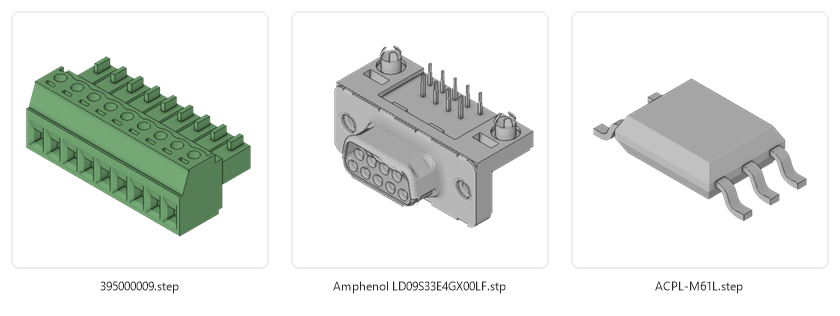
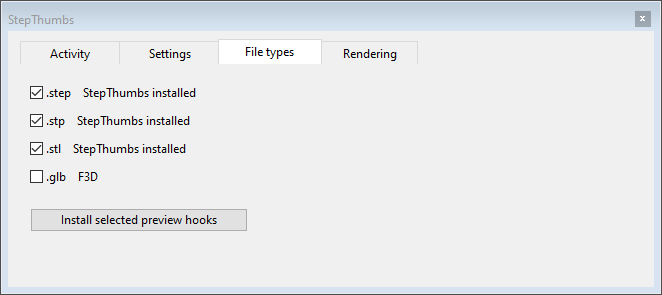

# StepThumbs

Fast 3D thumbnails for Windows Explorer, ready before you need them.

I've used F3D for a long time and truly appreciate it, but the time has come for
an upgrade. StepThumbs renders changed models quietly in the
background and keeps its own cache, so Windows clearing its thumbnails doesn't
mean starting over.



On my 6.7 MB STEP assembly, the modified Look renderer took about a second,
against 5–6 seconds with F3D. A cached thumbnail returned in 16 ms.

After the first scan, it watches for changes and renders changed files at low
priority. Explorer checks the disk cache first; a miss gets foreground priority.
The Rust tray app keeps RAM use low, sleeps when there's no work, and releases
its GPU resources. No service or periodic rescans, and no CPU/GPU work while idle.

It supports **STEP, STP, STL and GLB**, with source colours, edges, ambient
occlusion and transparent or coloured backgrounds. The quiet **3D** tray icon
opens activity, cache usage and settings for folders, file types and rendering.
Limit model size and background workers to keep larger jobs under control.
Rendering settings include a live preview; use the supplied model or load your own.

## Install

1. Download the [installer from Releases](../../releases/latest) and run it.
2. Open **StepThumbs** from the Windows Start menu. Its **3D** icon appears in the
   tray; check the hidden-icons arrow if you don't see it.
3. Right-click the icon and choose **Configure** to open **File types**.
4. Tick the extensions you want, click **Install selected preview hooks**, then
   choose **Yes** to replace the listed providers.

Use **Large icons** or **Extra large icons** in Explorer to see the thumbnails.
StepThumbs starts quietly with Windows after that.



Uninstall through Windows Settings; previous providers are restored where
StepThumbs still owns the hooks. Settings and cached images are kept.

Requires Windows 10/11 (64-bit), with a modern CPU and compatible GPU.

## Build

Clone with `--recurse-submodules`. With Rust/MSVC and the Windows SDK installed:

```sh
cargo build --release --locked
```

`cargo xtask dist` builds the installer with Inno Setup 7.1.1 installed.

## Credits

MIT licensed. Rendering is based on the excellent
[Look](https://github.com/stefangolas/look) by Stefan Golas and contributors.
[Our fork](https://github.com/stg/look/tree/stepthumbs-renderer) retains its
MIT OR Apache-2.0 license. Look's STEP coverage is incomplete.

Thanks also to [F3D](https://f3d.app/), the fast and minimalist 3D viewer by the
F3D-APP Foundation. It remains selectable if installed separately.
